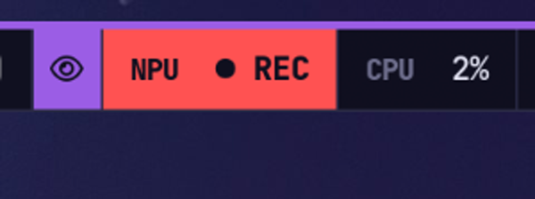

# npukit

[](https://github.com/Tjabooo/npukit/actions/workflows/ci.yml) [](https://github.com/Tjabooo/npukit/releases) [](LICENSE)

Put the AMD Ryzen AI NPU to everyday use on Linux: a local LLM API, push-to-talk dictation,
screenshot OCR and semantic search over your notes and code. All of it runs on the XDNA2 NPU through
[FastFlowLM](https://github.com/ROCm/FastFlowLM), and the model leaves the NPU as soon as it goes idle.



## Features

- **`npud`**: an OpenAI-compatible endpoint on `127.0.0.1:13306` (`/v1/chat/completions`, `/v1/embeddings`,
  `/v1/audio/transcriptions`, `/v1/models`). It owns the one FastFlowLM process the NPU can host, starts it on
  demand with whatever the last few requests needed (chat model, Whisper, embeddings), and stops it after an
  idle timeout that is shorter on battery. It is socket-activated: with nothing loaded it exits, so idle cost is zero.
- **Dictation** (`npu dictate`): press a key, talk, press again. The recorder starts at once and Whisper loads on
  the NPU while you talk. The text is typed into the focused app (`wtype`) and copied to the clipboard.
- **OCR** (`npu ocr`): select a screen region; a vision model on the NPU transcribes it to the clipboard.
  `--describe` or `--ask "…"` asks about the image instead.
- **Semantic search** (`npu index`, `npu search`): EmbeddingGemma on the NPU, an incremental SQLite index
  (git repos index tracked and untracked-but-not-ignored files), a systemd timer to keep it fresh,
  and a terminal or rofi front end that opens hits in your editor at the right line.
- **Power-aware**: a power mode per power source (`powersaver` on battery) and a shorter unload timeout on battery.
- **Status**: `npu status`, plus a waybar module that only changes when something happens (signal-driven, no polling).
- **`npu bench`**: tokens/s, time to first token and power (APU package power from the amdgpu sensor, system
  draw from the battery), for NPU models and for any other OpenAI-compatible server (e.g. llama.cpp on the iGPU).

## What runs where

| Piece | Runs on | Notes |
|---|---|---|
| Chat / coding LLMs (Qwen3.5, gpt-oss, Llama, Gemma…) | NPU | FastFlowLM; tokenizer and sampling on the CPU |
| Vision (OCR, describe) | NPU | Qwen3.5 / Qwen3-VL via FastFlowLM |
| Speech to text | NPU | Whisper large-v3-turbo via FastFlowLM |
| Embeddings | NPU | EmbeddingGemma 300M via FastFlowLM (expect ~half a CPU core of host work) |
| Recording, typing, search ranking | CPU | pw-record, wtype, numpy dot products |

The NPU has room for **one chat model plus one helper** (Whisper or embeddings): all three together fail with
`DRM_IOCTL_AMDXDNA_CREATE_HWCTX … Invalid argument`, and a second FastFlowLM process can't get an NPU context
while a chat model is loaded. `npud` handles this: when a request needs a third component it restarts
FastFlowLM with the two most recently used.

## Requirements

- AMD Ryzen AI 300/400 (XDNA2 NPU), Linux with the in-tree `amdxdna` driver (kernel 7.0+) and NPU firmware 1.1+
- [FastFlowLM](https://github.com/ROCm/FastFlowLM) (`flm`) **1.0.12 or newer**, with XRT and the amdxdna XRT plugin
  (Arch: `pacman -S fastflowlm`). Check the stack with `flm validate`. Before 1.0.12, `embed-gemma` returned vectors
  unrelated to the model (different after every restart) and stalled the NPU (`aie2_tdr_detect: TDR timeout` in the
  kernel log), so search results were noise. If your distro is behind, unpack the upstream
  `fastflowlm_<ver>_linux.tar.gz` anywhere and set `[server] flm = "/path/to/flm"`.
- Python 3.11+. numpy is optional (faster search); install it from your distro (`python-numpy`).
- Desktop tools: `pw-record` (PipeWire), `wl-clipboard`, `notify-send`, `rofi`, a region screenshotter that can
  print a PNG (`hyprshot --raw`, or `grim -g "$(slurp)" -`), and optionally `wtype` for typing dictated text.

## Install

```sh
git clone https://github.com/Tjabooo/npukit && cd npukit
./install.sh            # ~/.local/share/npukit + venv, ~/.local/bin/npu, systemd user units
flm pull qwen3.5:4b && flm pull whisper-v3:turbo && flm pull embed-gemma:300m
npu ask "hello"         # first request starts the gateway and loads the model
```

`install.sh` enables `npud.socket` (the gateway starts on the first request) and `npu-index.timer`
(index refresh every 30 minutes). Re-run it after `git pull`.

## Usage

```text
npu status                 gateway, loaded models, NPU runtime state, index size
npu models                 aliases + installed NPU models
npu load quality           load a model now (fast | quality | vision | any flm tag | stt | embed)
npu stop                   free the NPU
npu ask "question"         one-shot answer (add -m quality, --think)
npu dictate                toggle recording (also: start | stop | cancel)
npu transcribe file.wav    speech to text for a file
npu ocr [--describe]       screen region → text on the clipboard
npu index [--full]         update the search index
npu search "query"         semantic search (--rofi for the picker)
npu menu                   rofi menu with all of the above
npu bench fast quality --pmode powersaver,balanced,performance
npu bench --other Qwen3.5-4B-GGUF     # compare with a model on another server (default: Lemonade)
```

Any OpenAI client can use `http://127.0.0.1:13306/v1` with model names `fast`, `quality`, `vision` or any
FastFlowLM tag (Lemonade-style names like `qwen3.5-4b-FLM` work too).

### Hyprland

```lua
local npu = os.getenv("HOME") .. "/.local/bin/npu "
hl.bind("SUPER + SHIFT + Print", hl.dsp.exec_cmd(npu .. "ocr"))           -- region → text
hl.bind("SUPER + ALT + D",       hl.dsp.exec_cmd(npu .. "dictate"))       -- dictate toggle
hl.bind("SUPER + ALT + S",       hl.dsp.exec_cmd(npu .. "search --rofi")) -- semantic search
```

### Waybar

```jsonc
"custom/npu": {
  "exec": "cat ~/.local/state/npukit/bar.json 2>/dev/null || echo '{\"text\":\"NPU\",\"class\":\"off\"}'",
  "return-type": "json",
  "signal": 16,
  "on-click": "~/.local/bin/npu menu",
  "on-click-right": "~/.local/bin/npu stop"
}
```

Classes: `off`, `loading`, `ready`, `busy` (plus `stt`/`ocr`/`index` while a tool runs), `rec` while dictating, `error`.
The gateway rewrites the file and sends `SIGRTMIN+16` to waybar on every change, so the bar never polls.

## Configuration

`~/.config/npukit/config.toml`; every key is optional. See [`config.example.toml`](config.example.toml) for
all of them. The ones you'll most likely touch:

```toml
[models.aliases]
fast = "qwen3.5:4b"
quality = "gpt-oss:20b"
vision = "qwen3.5:4b"

[power]
battery_pmode = "powersaver"
battery_idle_unload = 120

[search]
roots = ["~/workspace", "~/notes"]
open = ["code", "-g", "{path}:{line}"]
```

## How it works

```
 tools (npu dictate/ocr/search, any OpenAI client)
          │  HTTP 127.0.0.1:13306
          ▼
   npud (asyncio, socket-activated) ── bar.json + SIGRTMIN+16 ──▶ waybar
          │  picks components, restarts / unloads on idle, pmode by power source
          ▼
   flm serve [chat model] [--asr 1] [--embed 1] --pmode … (private port)
          │
          ▼
   amdxdna NPU (/dev/accel/accel0)
```

- One request per connection; request and response bodies are relayed as-is (streaming included), with the
  `model` field mapped from aliases to FastFlowLM tags.
- FastFlowLM reports some failures as HTTP 200 with an `{"error": …}` body; the client treats those as errors.
- With nothing loaded the gateway sits in `epoll` with no timers; started by systemd, it exits after
  `exit_after` seconds and systemd starts it again on the next connection.

## Benchmarks

See [docs/benchmarks.md](docs/benchmarks.md).

## Development

```sh
python -m unittest discover -s tests -v    # uses tests/fake_flm.py, no NPU needed
```

## License

MIT
